Resolver conflitos pode ser uma tarefa árdua e complicada quando se trata de projetos git. Nesse artigo você vai aprender um passo-a-passo infalível para resolver conflitos.

Caso você já saiba o que são conflitos e queira apenas ver a lista de passos e comandos para resolver um conflito sugiro que [pule para a conclusão clicando aqui](#conclusao).

## O que é um conflito em git

Quando um projeto tem várias pessoas trabalhando ao mesmo tempo, é possível que duas pessoas precisem fazer alterações no mesmo pedaço de um arquivo. Quando mais de uma pessoa altera o mesmo pedaço de um arquivo em branches diferentes é nesse momento que os conflitos aparecem.

O conflito simboliza que duas ou mais alterações aconteceram no mesmo pedaço de um arquivo e o git não sabe qual das alterações manter.

## Como um conflito se forma

Na imagem abaixo temos um diagrama que eu carinhosamente apelidei de “anatomia de um conflito” que mostra os passos até que um conflito se forme. Vale salientar que normalmente, durante o ciclo de desenvolvimento de projetos, as alterações são maiores e por vezes em maior quantidade.

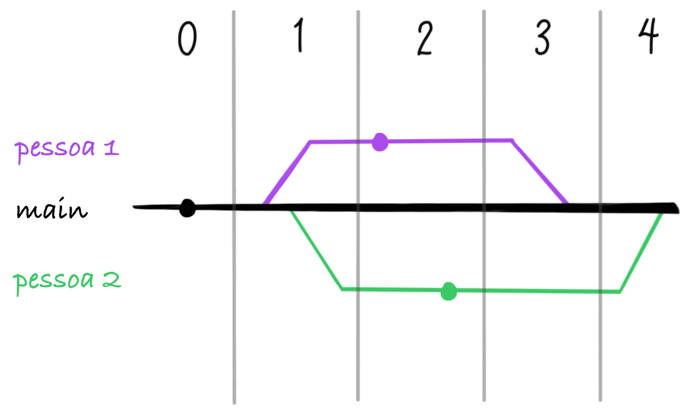

**0 -** No nosso projeto temos um `README.md` que foi adicionado pelo commit inicial no repositório. Depois da criação desse arquivo, duas alterações precisam ser feitas para adicionar mais algumas informações ao mesmo arquivo e duas pessoas vão fazer essa alteração;

**1 -** Cada pessoa então criou um branch a partir da `main` para trabalhar nas suas alterações, esses novos branches foram criados mais ou menos ao mesmo tempo, ou seja, eles possuem um mesmo ponto de partida;

**2 -** Durante algum tempo cada pessoa trabalha na sua branch implementando a sua alteração, que nesse caso é adicionar a linha _"pessoa x esteve aqui!"_ no arquivo de `README.md` sendo x o identificador da pessoa;

**3 -** A pessoa 1 faz um pull request e tem esse pull request aprovado e seu merge na `main`;

**4 -** A pessoa 2 por sua vez, faz o seu pull request para `main`, só que esse pull request **não** pode ser feito merge pois apresenta conflitos.

## Formando um conflito na prática

Para demonstrar como isso se apresenta, eu criei um repositório com um cenário parecido ao descrito na seção anterior [que você pode encontrar aqui](https://github.com/jtemporal/exemplo-conflito/branches). O arquivo inicial foi criado e as duas branches, uma para cada pessoa, também já foram criadas a partir da `main`, veja:

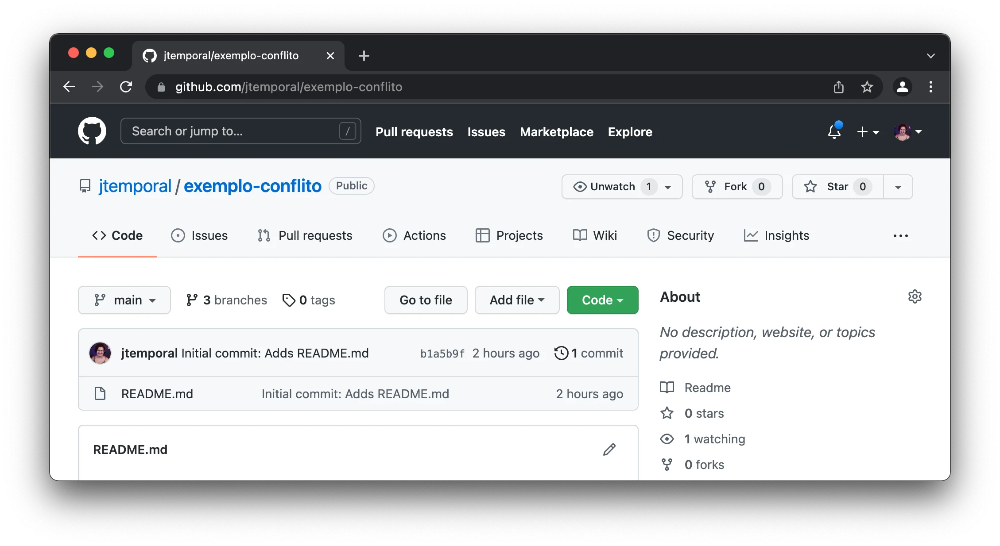

Em seguida fiz as alterações para cada pessoa, no branch `pessoa1` adicionei a descrição _"Pessoa 1 esteve aqui!"_ na última linha do `README.md` e de forma similar fiz o mesmo processo para o branch `pessoa2`. Então, abri os dois pull requests:

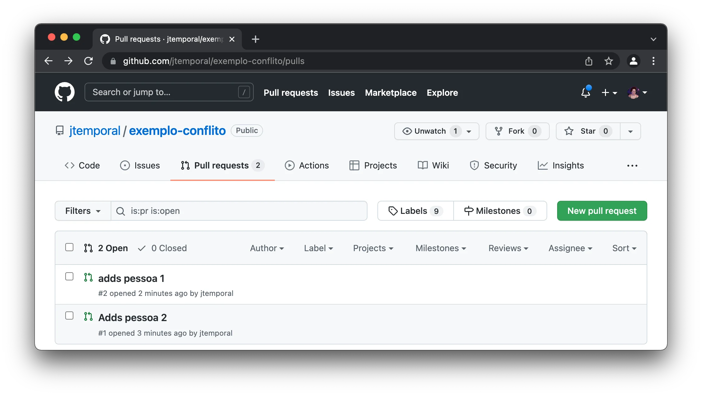

Revisei e dei o merge no pull request da `pessoa1`:

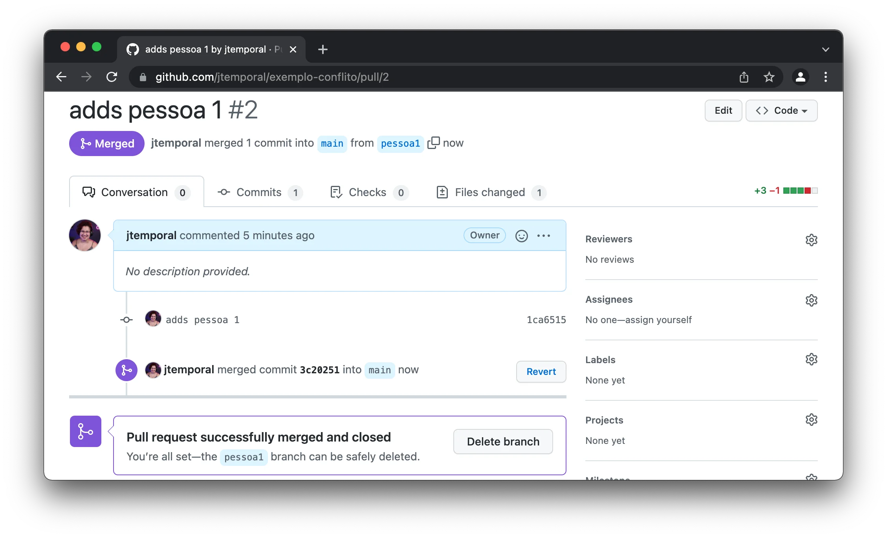

E então voltei para o PR da `pessoa2` e pude notar a indicação de que o pull request continha um conflito, veja:

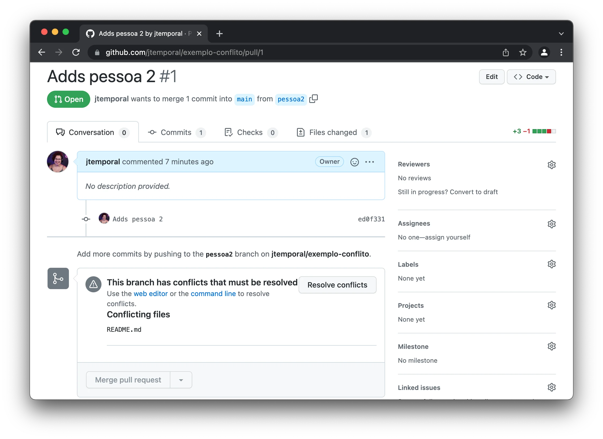

E agora com o conflito quentinho em mãos é hora de resolvê-lo.

## Resolvendo um conflito no Git

Antes de começar é importante notar que este tipo de conflito é possível resolver também pela interface do GitHub, mas o foco aqui são os comandos, então vamos lá!

A primeira coisa importante é decidir em qual branch resolver o conflito. Uma regra que geralmente funciona é resolver no branch que traz as alterações. Neste caso, esse branch é o `pessoa2`.

Antes de seguir, configure como o `git pull` deve lidar com branches divergentes. Nas versões mais recentes do Git, se o seu branch e o branch de onde você está trazendo as mudanças divergiram e você ainda não configurou uma estratégia de pull, o `git pull` é interrompido, mostra algumas dicas e termina com:

```
fatal: Need to specify how to reconcile divergent branches.
```

Configurar `pull.rebase` como `false` mantém o comportamento de merge que este post mostra. Você só precisa fazer isso uma vez por repositório. Se preferir não mexer na configuração do repositório, você pode passar `--no-rebase` só naquele pull.

```console
git config pull.rebase false
```

Agora sim, faça o checkout do branch e traga as mudanças da `main`:

```console
git checkout pessoa2
git pull origin main
```

Isso irá trazer o conflito para a sua máquina te dando um aviso informando que existem conflitos, que você deve resolver o conflito e fazer um commit com o resultado:

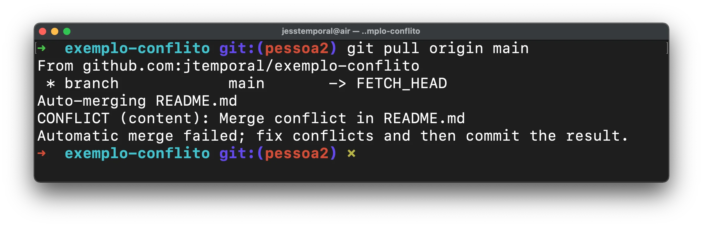

Se você abrir o `README.md` num editor de código, vai notar marcadores feitos de sucessivos sinais de menor que (`<`), sinais de igual (`=`) e sinais de maior que (`>`). Aqui um exemplo do conflito mostrado no Vim:

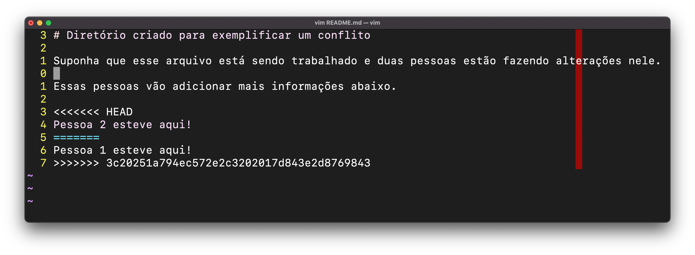

Também é possível que você use o VS Code que mostra o conflito de uma forma mais amigável já que ele marca visualmente, com cores diferentes, cada mudança de origem diferente e ainda te dá opções de como resolver o conflito aceitando parte das mudanças, ou as duas, ou nenhuma delas:

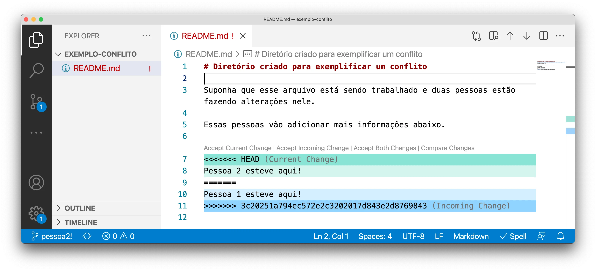

Para entender o que cada botão apresentado pelo VS Code quer dizer, vamos dissecar um pouco esse formato de representação. Um conflito pode ser dividido em duas partes:

1. **As nossas alterações:** aquelas que estão no branch corrente também chamadas de alterações atuais (_current change_);
2. **As alterações dos outros:** aquelas que trouxemos para a máquina local ao fazer `git pull` também chamadas de alterações que estão chegando ou de entrada (_incoming changes_).

Nesse formato, cada bloco é delimitado por um sinal de maior ou menor até o bloco de sinais de igual repetidos, então por exemplo nesse caso temos os seguintes blocos.

Aquele com as alterações atuais:

```console
<<<<<<< HEAD
Pessoa 2 esteve aqui!
=======
```

E aquele com as alterações que estão chegando:

```console
=======
Pessoa 1 esteve aqui!
>>>>>>> 3c20251a794ec572e2c3202017d843e2d8769843
```

Como queremos deixar ambas alterações, podemos apenas apagar as linhas com os marcadores salvar o arquivo, se você estiver usando editores mais simples. No VS Code podemos apertar em _"Accept both changes"_ e continuar com os comandos a seguir. Após aceitar todas as mudanças, manualmente ou usando os botões no VS Code, você deve ter um arquivo assim:

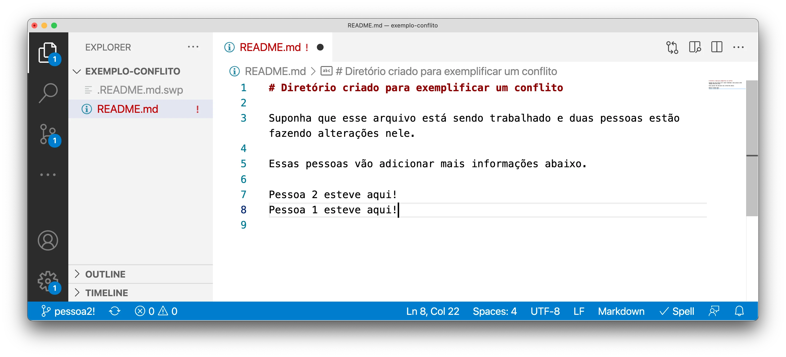

Lembre-se de salvar o arquivo. Em seguida volte para o terminal, se você rodar o comando `git status` vai ver que o arquivo `README.md` se mostra com alterações.

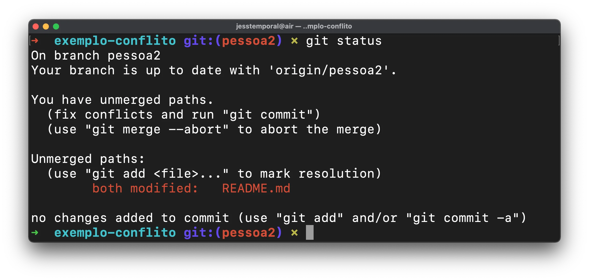

Agora você pode adicionar esse arquivo em staging com o seguinte comando:

```console
git add README.md
```

E fazer o commit das alterações da forma que preferir. Note que ao fazer o commit, se você usar editores para escrever a mensagem de commit, é possível que essa mensagem já venha pré-preenchida como na imagem abaixo:

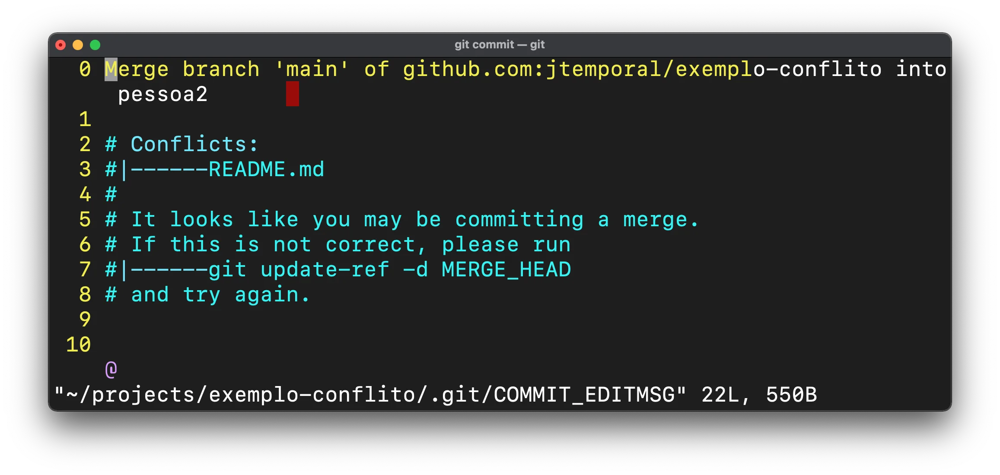

Você pode personalizar a mensagem ou deixá-la como está e, ao terminar de fazer o commit, enviar essas alterações para o GitHub com um `git push`:

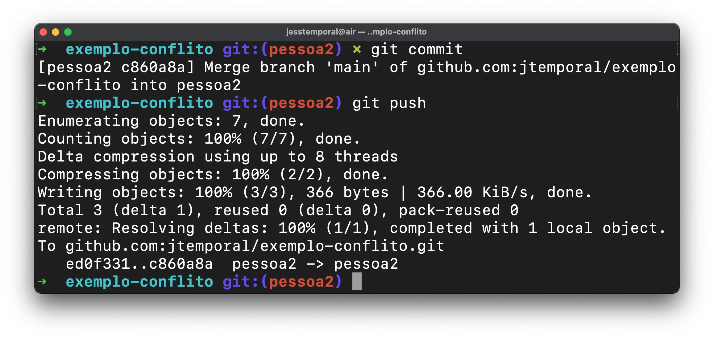

Agora se você recarregar a página do pull request deverá ver que o conflito foi resolvido, observe:

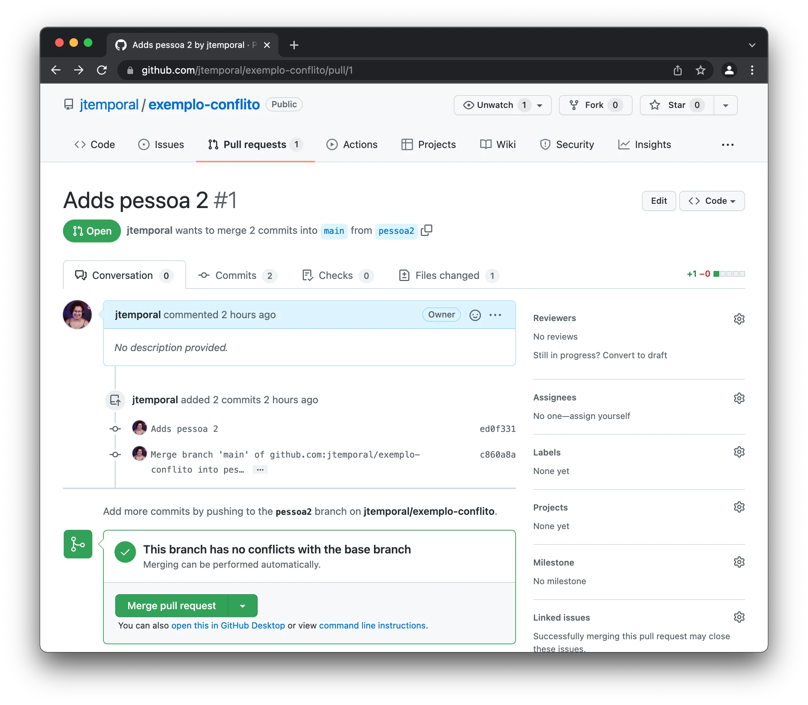

E podemos finalmente dar merge neste pull request! Vitória! 🎉🎉

## Conclusão<a name="conclusao"></a>

Você agora entende como os conflitos se formam e também sabe todos os passos envolvidos em resolver conflitos.

Aqui está a lista simples de todos os comandos e passos para resolver conflitos, lembre de substituir as notações `<>` de acordo:

1. `git config pull.rebase false` uma vez por repositório
2. `git checkout <nome do branch com conflito>`
3. `git pull origin main`
4. abra o arquivo com conflito e resolva
5. salve o arquivo
6. `git add <nome do arquivo alterado>`
7. `git commit`
8. `git push`

Espero que esse artigo te ajude a resolver os conflitos de git que você encontrar daqui pra frente. 😉

---

## Leitura extra

Seguem mais umas dicas de documentações em português para você aprender sobre resolução de conflitos no git

* [O diretório de fichas de estudo sobre git GitFichas](https://gitfichas.com)
* [A documentação do GitHub sobre resolução de conflitos](https://docs.github.com/pt/pull-requests/collaborating-with-pull-requests/addressing-merge-conflicts/about-merge-conflicts);
* [O tutorial da Atlassian também sobre resolução de conflitos](https://www.atlassian.com/br/git/tutorials/using-branches/merge-conflicts).