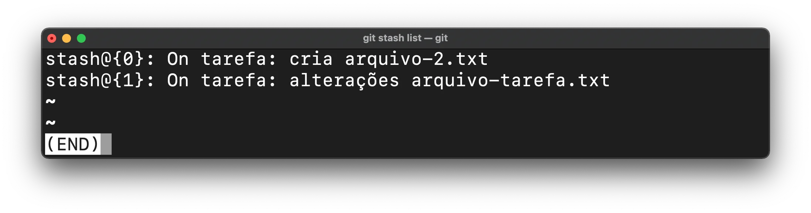
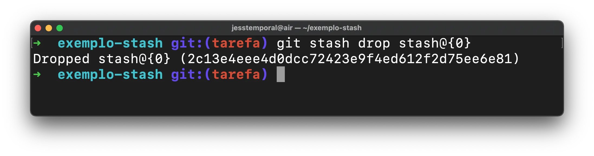
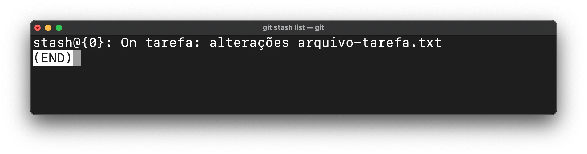

Tá precisando limpar a lista de stashes e não sabe como? Não se preocupe, nessa colinha você vai aprender a "jogar fora" stashes que não precisa mais usando o comando `git stash drop`. 😉

## O fluxo comum de uso do git stash

Comumente você provavelmente usa o git stash para armazenar mudanças temporárias e que ainda não estão prontas para um commit. Muitas vezes isso acontece quando você precisa interromper o trabalho para corrigir um bug ou algo similar em outra branch. Então o seu fluxo de trabalho deve ser algo semelhante a esse:

```console
# trabalha trabalha trabalha
git stash
# muda de branch e faz outras entregas
# volta pro branch inicial
git stash pop
```

E até aí tudo bem, mas o que acontece quando você armazena mudanças por outro motivo, por exemplo, limpar o ambiente de trabalho? Eventualmente você vai querer se livrar dessas mudanças para manter a casa limpa não é mesmo? É nessa hora que entra o `git stash drop`.

## Jogando fora um stash

Stashes antigos podem ser fonte de muita dor de cabeça, _sim conflitos, eu estou falando de vocês_, então é importante manter a lista de stashes sempre em dia. Suponha que atualmente você tem a lista a seguir de stashes:



Você quer se livrar do stash de número `0` que contém a criação do `arquivo-2.txt`. Para isso rode o comando a seguir:

```console
git stash drop stash@{0}
```

Você deverá ver uma mensagem informando que o stash foi removido:



Em seguida, você pode conferir novamente a listagem de stashes:



Vale salientar que assim como o [`git stash pop`](https://jtemporal.com/usando-git-stash-e-git-stash-pop), se você não passar o nome do stash para o comando `git stash drop` ele vai remover o stash mais recente da pilha.

## GitFichas













Espero que esses comandos te ajudem a remover stashes quando necessário.
